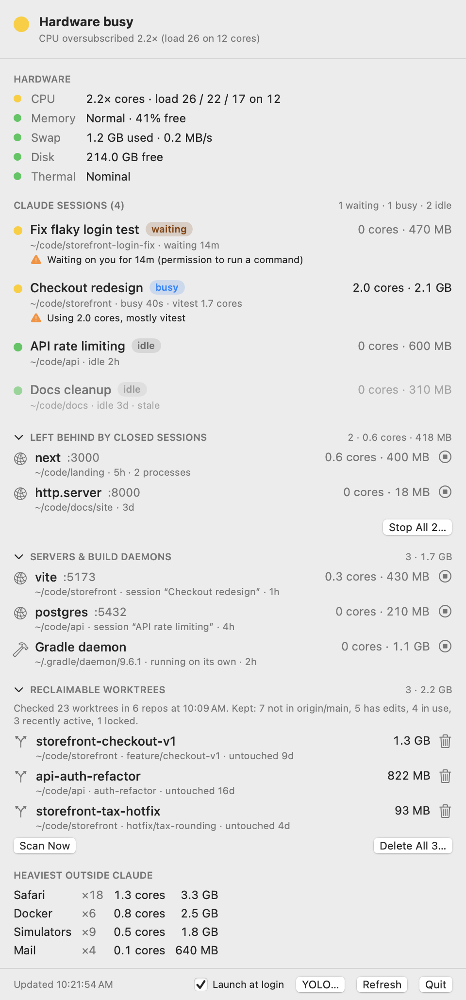

# Claude Monitor

A macOS menu bar app that shows:

- **Hardware health rollup** (green / yellow / red): is the machine overloaded?
- **Every running Claude Code session**: status, the CPU and memory used by everything it started, and whether it needs attention.
- **Leftover servers and build processes**: what closed sessions left running, every dev server listening on a port, and build daemons running on their own, each with a button to stop it.
- **Reclaimable git worktrees**: worktrees that are safe to delete, how much disk they'd free, and a button to delete them.

The menu bar shows a colored dot (the hardware rollup) and the number of Claude sessions. If any session is waiting on you, it also shows `· N⏳`. Click it for details.

<p align="center">
  <picture>
    <source media="(prefers-color-scheme: dark)" srcset="docs/screenshot-dark.png">
    
  </picture>
</p>

<p align="center"><sub>Sample data. The popover scrolls; this screenshot is taller to show every section.</sub></p>

## Install

Requires macOS 14 (Sonoma) or later on Apple Silicon or Intel.

**[⬇ Download the installer: ClaudeMonitor-0.1.2.pkg](https://github.com/sdruckerfig/claudemonitor/releases/download/v0.1.2/ClaudeMonitor-0.1.2.pkg)** (no developer tools needed; see [Installer package](#installer-package) below, or [all releases](https://github.com/sdruckerfig/claudemonitor/releases)).

**One-line install** (builds from source; needs Apple's Command Line Tools, `xcode-select --install`, but not Xcode):

```sh
curl -fsSL https://raw.githubusercontent.com/sdruckerfig/claudemonitor/main/install.sh | bash
```

Or from a clone: `./install.sh`. Options:

| Option | Effect |
|---|---|
| `--login` | also start Claude Monitor at login |
| `--system` | install into `/Applications` instead of `~/Applications` |
| `--dir DIR` | install into `DIR` |
| `--no-launch` | don't launch after installing |
| `--ref REF` | branch or tag to build (curl install only) |

<a id="installer-package"></a>**Installer package** (no developer tools needed): [download ClaudeMonitor-0.1.2.pkg](https://github.com/sdruckerfig/claudemonitor/releases/download/v0.1.2/ClaudeMonitor-0.1.2.pkg) (or the newest from the [latest release](https://github.com/sdruckerfig/claudemonitor/releases/latest)) and open it. It's universal (Apple Silicon + Intel), signed with a Developer ID and notarized by Apple. Clicking **Install** on the Installation Type step installs for all users into `/Applications` and asks for an administrator password. To install into `~/Applications` instead, click **Change Install Location…** and choose **Install for me only**. Do that if you already installed with the script, so the package replaces that copy instead of adding a second one.

To build the package yourself, run `scripts/make-pkg.sh`. Without options it's unsigned. With your own Developer ID certificates, `--team TEAMID` signs it, and `--team TEAMID --notarize PROFILE` also notarizes and staples it, so macOS opens a downloaded copy without an Open Anyway step in Privacy & Security (see the script's header).

Installing a new version, with either the script or the package, starts the new copy, and it quits any older copy that's running. If you have copies in both `~/Applications` and `/Applications`, the one launched last keeps running.

**Uninstall:**

```sh
curl -fsSL https://raw.githubusercontent.com/sdruckerfig/claudemonitor/main/uninstall.sh | bash
```

Or `./uninstall.sh`. It quits the app, turns off launch at login, and removes the app from `~/Applications` and `/Applications` along with any installer receipt. If you installed with `--dir DIR`, run `./uninstall.sh --dir DIR`. It never touches your worktrees or sessions.

**Command-line modes** (no UI, one at a time; `--print` and `--worktrees` are read-only, `--login-item on|off` changes the login item). Launch at login is registered by bundle ID, so every installed copy shares it: `--login-item off` from any copy turns it off for all of them.

These examples use `~/Applications`; if you installed for all users, use `/Applications`.

```sh
~/Applications/ClaudeMonitor.app/Contents/MacOS/ClaudeMonitor --print        # one health snapshot
~/Applications/ClaudeMonitor.app/Contents/MacOS/ClaudeMonitor --worktrees    # list reclaimable worktrees (never deletes)
~/Applications/ClaudeMonitor.app/Contents/MacOS/ClaudeMonitor --login-item [on|off|status]
~/Applications/ClaudeMonitor.app/Contents/MacOS/ClaudeMonitor --version
~/Applications/ClaudeMonitor.app/Contents/MacOS/ClaudeMonitor --help
```

**Development:** `swift build`, `scripts/test.sh`, and `scripts/build-app.sh [--universal]`, which builds `build/ClaudeMonitor.app`. The tests use Swift Testing, which needs a Swift 6 toolchain (Command Line Tools 16 or later). `scripts/test.sh` runs `swift test` and, with only the Command Line Tools installed, points the compiler at the Testing macro plugin, which SwiftPM sometimes fails to find. `scripts/screenshot.sh` re-renders the README screenshots from made-up data in `Sources/MonitorCore/DemoData.swift`, never from your own sessions or worktrees.

## Hardware rollup

The worst of these checks sets the rollup:

| Check   | Yellow | Red |
|---|---|---|
| CPU     | 1-minute load ≥ 1.5× cores | ≥ 3× cores |
| Memory  | kernel memory pressure "warning" | "critical" |
| Swap    | swapping ≥ 5 MB/s, or swap in use ≥ 25% of RAM | swapping ≥ 50 MB/s (thrashing) |
| Disk    | < 20 GB free | < 5 GB free |
| Thermal | serious | critical |

All thresholds are in `Thresholds` (`Sources/MonitorCore/Health.swift`).

## Sessions

Sessions are read from `~/.claude/sessions/<pid>.json`. This is an internal Claude Code format, so every field except `pid` is treated as optional. Each session is charged for its whole process tree. That includes background jobs it detached (`nohup`, build daemons), which are found because Claude Code puts `CLAUDE_CODE_SESSION_ID` and `CLAUDE_PID` in the environment of every command it runs, and everything those commands start inherits them, or because their command lines contain the session ID (usually through its scratchpad path). An app a session happened to launch, such as Docker Desktop, isn't charged to it. Processes left behind by sessions that have exited are listed separately (see below).

| Session | When |
|---|---|
| Red | ≥ 6 cores, ≥ 10 GB, or the process is stopped or a zombie |
| Yellow | ≥ 2 cores, ≥ 4 GB, or waiting on you for ≥ 10 min |
| Stale (dimmed when otherwise green) | idle for ≥ 24 h |

Right-click a session to reveal its folder, copy its PID, copy a `claude --resume` command, or end it (SIGTERM, with confirmation). Click a session to list the processes it started, with any ports they listen on. Right-click one to stop it and everything under it (a runaway build or test run, say), or to force-stop it.

## Leftover servers and build processes

Two sections list processes you may want to stop:

- **Left behind by closed sessions**: every process tree a Claude session started and left running after it closed, such as a dev server, a `tail -f`, or a build. A process counts when its environment names a session that is no longer running, or its command line contains a Claude shell snapshot or scratchpad path. It must also have nothing still running that started it: not an open app, and not a `claude` process without a session file (`claude -p`). **Stop All** stops every one.
- **Servers & build daemons**: every other process listening on a TCP port, plus build daemons running on their own after their build exited (Gradle, Kotlin, MSBuild nodes, the C# compiler server, `esbuild`, `tsc --watch` and the like). Each row says who started it: a session, the app it runs under (Terminal, an editor), or "running on its own". These may still be in use, so they're stopped one at a time.

Each row is a job: the process plus everything it started, named after what it runs (`vite`, `http.server`, `Gradle daemon`), with its ports, folder, age, CPU and memory. Identical jobs with no ports are listed once ("MSBuild node ×11"). A server's job starts at the topmost process that only started it, so stopping vite also stops the `npm run dev` above it, and a `node --watch` supervisor can't restart it. Right-click a row to open its port in a browser, reveal its folder, or copy its command.

**Stop** asks for confirmation, then sends SIGTERM (**Force Stop** sends SIGKILL). First it reads the process table again, and it stops only the processes that are still the same ones, judged by start time, since pids are reused. It also stops anything those processes have started since. A suspended process is continued so it can act on SIGTERM. A few seconds later the app reports whatever is still running.

These are never listed or stopped: other users' processes, macOS's own, installed apps and their helpers, `claude` itself, interactive shells, `tmux`, `screen`, `sshd`, `login`, `sudo`, and jobs launchd manages (Homebrew services, login agents). A job never reaches past one of them, so stopping a server in a tmux pane leaves tmux and the pane's shell running. Servers under a launchd job are left out, since launchd may restart them. If `launchctl list` can't be read, nothing outside Claude counts as running on its own.

To find these, the app reads each of your processes' working folder, listening sockets and executable path through libproc. It also reads their environment, but only to look for `CLAUDE_CODE_SESSION_ID` and `CLAUDE_PID`. Everything else in the environment, which can hold tokens and keys, is skipped without being copied, and the buffer is zeroed afterwards. Nothing is stored or sent anywhere. For apps and macOS's own processes it reads only the owner and executable path, which is how it tells them apart.

The rules are in `Sources/MonitorCore/Jobs.swift`, `ProcessKind.swift` and `ProcessStopper.swift`.

## Reclaimable worktrees

20 seconds after launch, then every 30 minutes (and when you click **Scan Now**), it looks for git repos up to two levels below `~`, plus the main repos of any linked worktrees it finds there. It skips hidden folders and `Library`, `Applications`, `Movies`, `Music`, `Pictures`, `Downloads`, `Dropbox` and `node_modules`. It then checks each *linked* worktree. Main checkouts are never candidates.

Deleting a worktree must never lose work, so every rule **fails closed**: if a check can't prove the worktree holds nothing unique, the worktree is kept. A worktree is offered for deletion only if all of these are true:

1. **It's still there:** it isn't locked and its directory exists.
2. **Nothing is using it:** no open Claude session has its cwd there, it isn't inside a live session's scratchpad, and no process has its cwd there or names its path on the command line. Paths are compared case-insensitively, as macOS volumes usually are. If the list of running processes or their working folders can't be read, no worktree is offered.
3. **It contains no other worktree.** Claude Code puts agent worktrees under `<checkout>/.claude/worktrees/`, and removing the parent would take them along.
4. **It's idle:** nothing has happened in it for **24 h** (judged by its `HEAD`, its index and the newest entry in its `HEAD` reflog), so a worktree a session just created isn't raced. Running `git gc` in the main checkout doesn't count as activity. If the time can't be read, the worktree counts as active.
5. **Nothing is paused in it:** no rebase, `git am`, merge, cherry-pick, revert, bisect or notes merge is in progress. That state lives in the worktree's git directory, and `git status` doesn't show it. Submodules initialised in the worktree keep their repositories there too (`modules/`), so their presence keeps it. A worktree whose git config sets `core.worktree` is kept too, because git commands run there would look at a different folder.
6. **Everything is in origin/main.** The base is the first of the remote-tracking refs `origin/main`, `origin/HEAD` and `origin/master` that exists (a local branch or tag that happens to be named `origin/main` doesn't count). `HEAD` must be an ancestor of the base. A worktree on a branch, which is kept, can also qualify if it has at most 200 commits, none of them merges, and every one has a patch-identical counterpart in the base (a rebase merge, checked with `git cherry`, and only when the base is at most 1,000 commits past the fork point). A detached `HEAD` must be an ancestor. Squash-merged branches are *kept*, because git can't prove them merged.
7. **No commits would be orphaned:** every commit in the worktree's `HEAD` reflog or its own refs and their reflogs (`refs/worktree/*`, `refs/bisect/*`, `refs/rewritten/*`) is still reachable from a branch, tag, remote ref, or (for a branch worktree) the branch's own reflog. Removing a worktree deletes its `HEAD` reflog and its own refs, after which git would garbage-collect commits only they remembered.
8. **No edits, including hidden ones:**
   - `git status` shows nothing. It runs with untracked files always shown, submodules never ignored, and full change detection (`core.trustctime` and `core.checkStat` at their strictest), whatever the repo's config says. (`core.fileMode` stays as the repo has it: a permission-only change loses nothing.)
   - Nothing below the top folder is named `.git`, in any letter case. Git silently skips such entries unless they hold a working repository, so `git status` can't vouch for them. The exception is a repository inside a dependency or cache folder (SwiftPM keeps each package as a clone in `.build/checkouts`) with nothing of its own: a clean working tree, no stash, and no commit that isn't on one of its remote branches or tags.
   - No file marked skip-worktree or assume-unchanged has a copy on disk. Paths a sparse checkout leaves out are fine.
   - There are no submodules.
   - No tracked file goes through a clean filter other than Git LFS, since a filter can make an edited file look unchanged.
9. **No unique ignored files.** Every ignored file must have a byte-identical copy in the main checkout (for a symlink, the same target), as with `.env.local`. The copy must really be in the main checkout: if a folder on the way to it is a symlink, it could lead back into the worktree itself, so it doesn't count. Any other file that isn't tracked needs a copy too: `git status` never saw it, so it appeared while the checks ran. Finder's own files (`.DS_Store`, `._*`) don't count. Dependency and cache folders (`node_modules`, `.build`, `DerivedData`, `Pods`, `.venv`, `__pycache__`, `.next`, …) can be regenerated, so their contents aren't compared. Build-output names (`bin`, `obj`, `build`, `dist`, `out`, `target`, `coverage`, `.cache`) count as regenerable only when the main checkout has the same folder. Otherwise their files are compared like any others. If more than 5,000 ignored files would need comparing, the worktree is kept.

Deleting re-runs every check first, against the worktrees of every repo found. Right before deleting, it checks once more that nothing has started using the worktree, that nothing in its git directory (`HEAD`, index, refs, reflogs) changed while it was checking, and that no folder in it and no compared ignored file changed either. It then runs `git worktree remove` without `--force`, so git itself refuses if edits appeared since the scan. A message git kept in the worktree that was never used (a commit a hook rejected, an unfinished merge or squash message, or the message of a tag or note git couldn't create) would be deleted with it, so it is first saved to `~/Library/Application Support/ClaudeMonitor/Saved commit messages/`. If git stops partway, say on a file it isn't allowed to delete, it has usually already deleted the worktree's git directory and unregistered it. The saved messages are then kept, and the app says which folder was left behind. Branches are kept. Sizes come from `du` and are approximate, since hard links and APFS clones can be counted in full.

The rule settings are in `WorktreePolicy` (`Sources/MonitorCore/Worktrees.swift`); the scan interval is `MonitorModel.worktreeInterval`. The `Tests/MonitorCoreTests/DestructivePath*Tests.swift` files hold one throwaway-repo test per way a worktree could hide work.

`origin/main` is whatever the last `git fetch` left. The app never fetches. A stale ref only makes it more conservative.

## Layout

```
Sources/MonitorCore/     testable logic: ps parsing, process details (libproc), attribution, leftover and server rules, stopping, health rules, worktree rules
Sources/ClaudeMonitor/   AppKit status item + SwiftUI popover
Tests/MonitorCoreTests/  swift test (includes end-to-end worktree tests on throwaway repos)
scripts/                 build-app.sh, make-pkg.sh (+ pkg/postinstall), test.sh, screenshot.sh
docs/                    README screenshots (rendered from sample data)
```

SwiftUI's `@State` and other macros can't be expanded under Command Line Tools, so view state lives in `MonitorModel` as `@Published` properties.

## License

MIT. See [LICENSE](LICENSE).

Claude Monitor is an independent project. It isn't made, endorsed or supported by Anthropic. Claude and Claude Code are trademarks of Anthropic.
